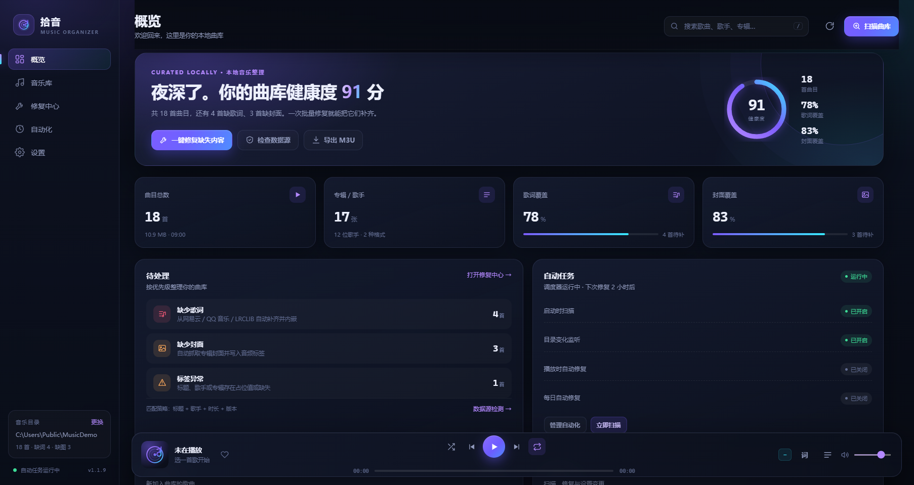
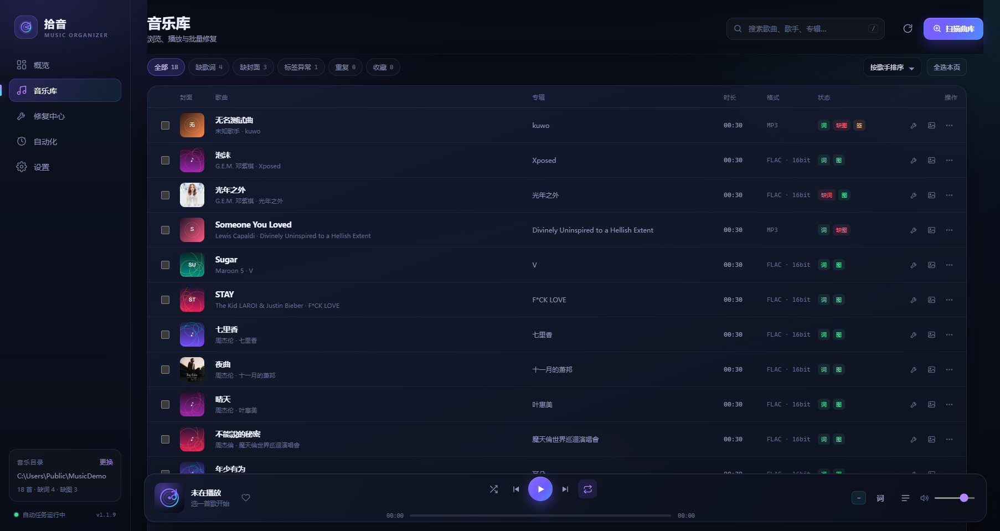
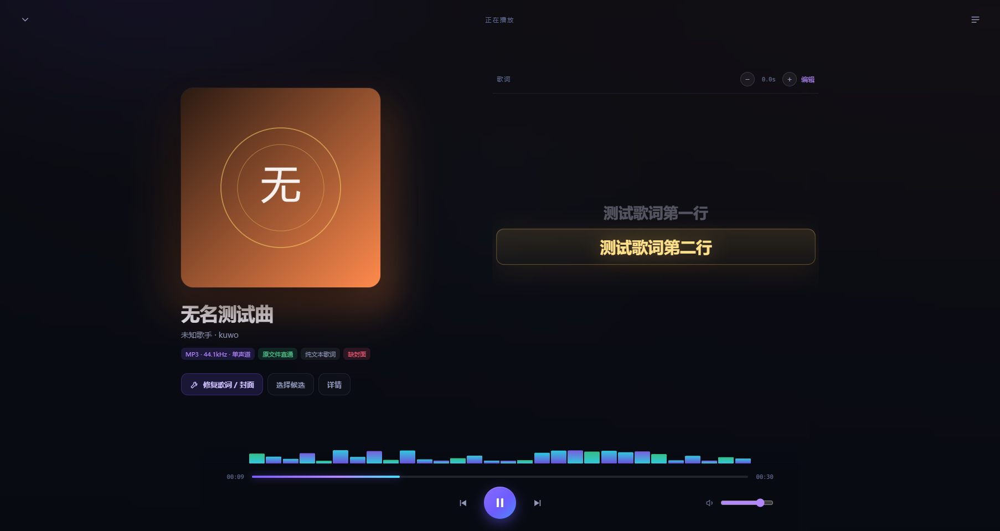
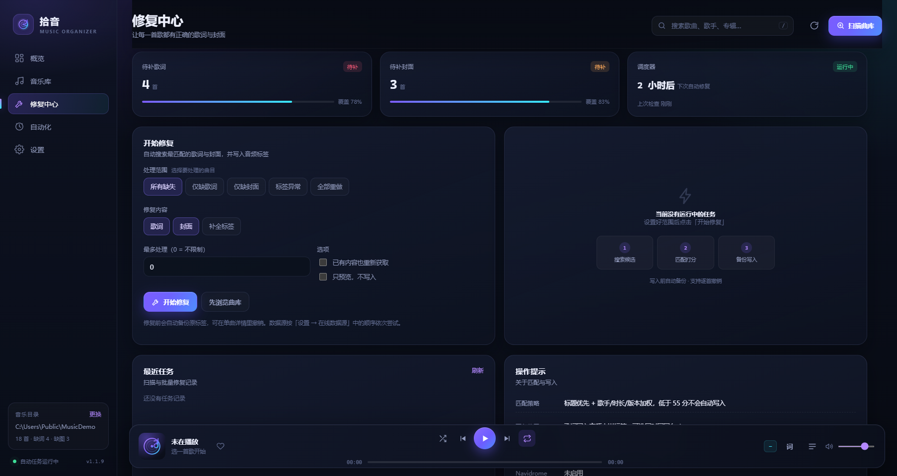
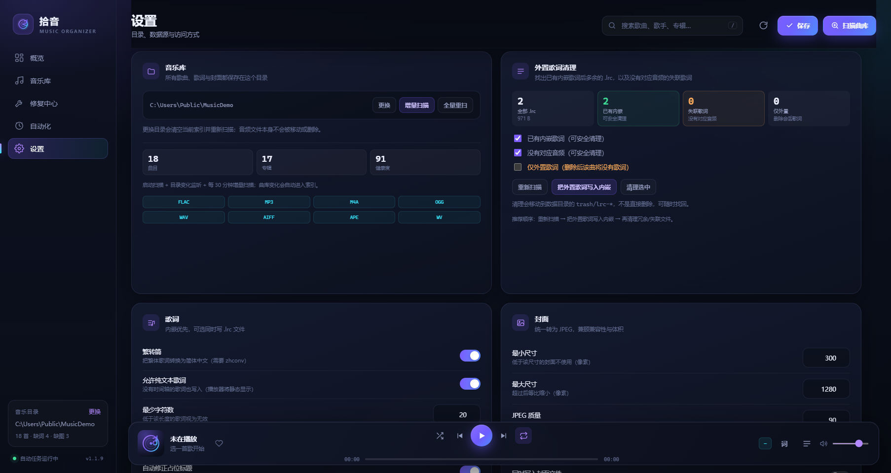
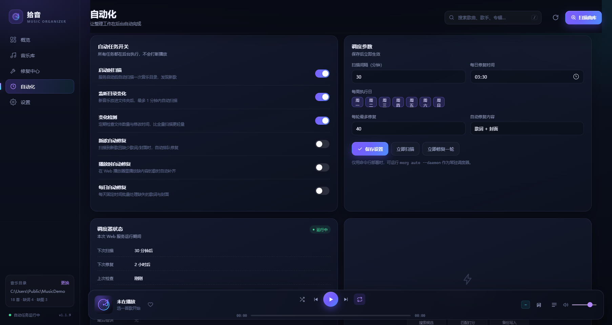
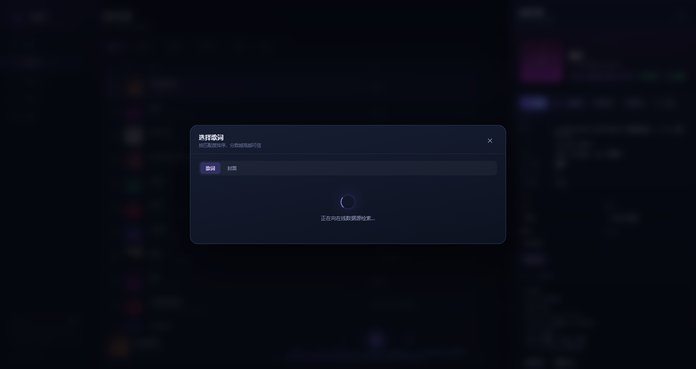
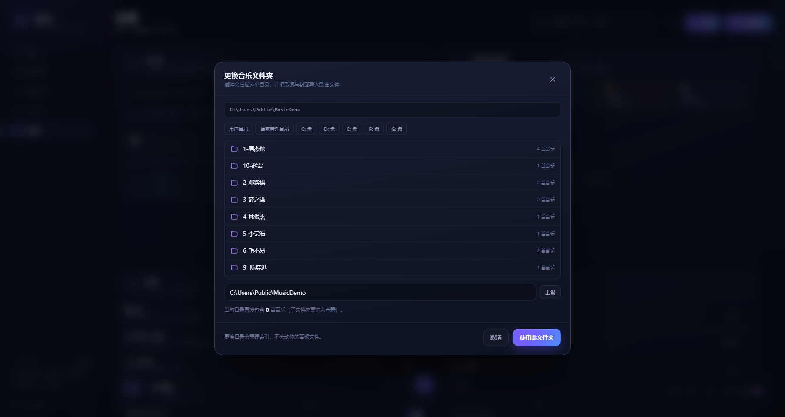

# 拾音 · 本地音乐整理小插件

> 给树莓派上的本地音乐一次「补全」：歌词、封面、标签、重复文件，就地整理。
> **Web 管理 + 终端 CLI 双形态**，也可以只装其中一个。



这是一个为 **树莓派 5 + 本地音乐目录 + Navidrome** 场景写的轻量工具：

- 第一次使用时选择音乐文件夹（例如 `/home/pi/Music`），之后所有扫描、修复都围绕它；
- 扫描曲库，找出缺歌词、缺封面、标签异常、重复文件；
- 从网易云音乐 / QQ 音乐 / LRCLIB / iTunes 获取歌词与封面，**直接写入音频标签**；
- 修复前自动备份，支持撤销；批量修复有进度、可取消；
- 可选 Web 播放器：播放时发现歌词不对，点一下「修复歌词 / 封面」即可重新拉取；
- 自动任务：新歌自动扫描、播放时自动修复、每天定时批量修复；
- 可选联动 Navidrome：修复完成后通知它重新扫描。

> 项目目录名是「本地音乐整理小插件」，界面品牌叫「拾音」，命令行叫 `morg`。

---

## 目录

- [界面预览](#界面预览)
- [功能一览](#功能一览)
- [支持格式](#支持格式)
- [快速开始](#快速开始)
- [第一次配置](#第一次配置)
- [Web 管理](#web-管理)
- [终端命令](#终端命令)
- [自动任务](#自动任务)
- [备份、撤销与回收站](#备份撤销与回收站)
- [Navidrome 联动](#navidrome-联动)
- [配置说明](#配置说明)
- [常见问题](#常见问题)
- [与开源项目的关系](#与开源项目的关系)
- [目录结构](#目录结构)
- [开发与测试](#开发与测试)
- [安全建议](#安全建议)
- [许可证](#许可证)

---

## 界面预览

| 音乐库 | 播放器 / 歌词 |
| --- | --- |
|  |  |

| 修复中心 | 设置 · 外置歌词清理 |
| --- | --- |
|  |  |

| 自动化 | 歌词候选 |
| --- | --- |
|  |  |

| 文件夹选择 | 手机端 |
| --- | --- |
|  |  |

| 手机播放页 | 登录页 |
| --- | --- |
|  |  |

> 截图来自公开演示曲库（18 首），不包含任何真实用户数据。

---

## 功能一览

| 模块 | 能力 |
| --- | --- |
| **音乐库** | 选择目录、增量扫描、全量重扫、健康度、歌词/封面覆盖率、格式分布 |
| **歌词** | 网易云 / QQ / LRCLIB，多候选、匹配打分、繁转简、翻译合并、内嵌或 `.lrc` |
| **歌词时间轴** | 自动检测时长/位置不匹配、超出结尾、明显逆序、覆盖不完整，并自动重新匹配 |
| **封面** | 网易云 / QQ / iTunes，候选预览、尺寸校验、转 JPEG、上传替换、内嵌 |
| **修复** | 单曲 / 多选 / 按状态批量、dry-run、强制重取、失败重试上限、实时进度 |
| **标签** | 编辑标题/歌手/专辑/年份，只补缺失与占位值，不覆盖有效值；自动修正 `track 04` / `kuwo` 等占位标题 |
| **自动化** | 启动扫描、目录变化监听、定时扫描、新歌修复、播放时修复、每日定时修复 |
| **Web** | 概览、音乐库、修复中心、自动化、设置、播放器、逐行歌词、队列、密码登录 |
| **播放** | 原文件直通不转码、断流自动续播、居中高亮歌词、EQ 频谱、音量控制 |
| **外置歌词** | 扫描 `.lrc`、写入内嵌、清理冗余/失联歌词（移入回收站） |
| **CLI** | 20+ 个命令，全部支持 `--json`，可在 SSH / cron / 脚本里使用 |
| **整理** | 重复文件检测、移入回收站、M3U 导出、按标签重命名（默认预演） |
| **运维** | 一键安装、systemd、日志、环境自检、数据源连通性、Navidrome / Jellyfin 联动 |

更细的清单（含路线图与「明确不做」）见 [FEATURES.md](FEATURES.md)。

---

## 支持格式

| 格式 | 读标签 | 写标签 / 歌词 / 封面 |
| --- | --- | --- |
| FLAC | ✅ | ✅ |
| MP3 | ✅ | ✅（ID3v2.3） |
| M4A / MP4 | ✅ | ✅ |
| OGG / Opus | ✅ | ✅ |
| WAV | ✅ | ✅（ID3） |
| AIFF / AIF | ✅ | ✅（ID3） |
| APE / WavPack | ✅ | ✅（APEv2） |
| AAC (ADTS) 等 | ✅ | ❌ 只读 |
| DSF / DFF / WMA | ❌ | ❌ 路线图 |

> 封面会统一转成 JPEG（质量默认 90），避免不同播放器对 PNG/WebP 支持不一致。

---

## 快速开始

### 方式一：一键安装（推荐，树莓派 / Debian）

```bash
# 把整个项目目录传到树莓派，例如 ~/music-organizer
cd ~/music-organizer
chmod +x install.sh
sudo ./install.sh
```

脚本会：

1. 检查 Python 3.9+，必要时安装 `python3-venv`；
2. 复制程序到 `/opt/music-organizer`，创建独立 venv；
3. 安装 Flask / mutagen / Pillow / waitress / zhconv；
4. 安装 `morg` 命令到 `/usr/local/bin/morg`；
5. 注册并启动 `music-organizer.service`；
6. 输出访问地址（默认 `http://<树莓派IP>:8090`）。

自定义参数：

```bash
sudo MORG_PORT=8091 ./install.sh
sudo MORG_USER=wu ./install.sh
sudo MORG_PIP_INDEX=https://pypi.tuna.tsinghua.edu.cn/simple ./install.sh
```

只装 CLI、不注册服务：

```bash
MORG_INSTALL_DIR="$HOME/music-organizer" MORG_NO_SERVICE=1 ./install.sh
```

查看服务：

```bash
systemctl status music-organizer
journalctl -u music-organizer -f
```

### 方式二：手动安装（开发 / 其它 Linux）

```bash
python3 -m venv .venv
. .venv/bin/activate
pip install -r requirements.txt

# 初始化音乐目录（也可以稍后在网页里选）
python -m music_organizer init --path /home/pi/Music

# 启动 Web
python -m music_organizer web --host 0.0.0.0 --port 8090
```

Windows 开发机同理，把路径换成 `D:\Music` 之类即可。

### 方式三：只使用终端

```bash
pip install -r requirements.txt
morg init --path /home/pi/Music
morg scan
morg check
morg fix --limit 20
```

---

## 第一次配置

### 图形界面

1. 打开 `http://<树莓派IP>:8090`；
2. 首次打开会弹出目录选择器，逐级进入音乐文件夹（例如 `/home/pi/Music`）；
3. 点击「使用此文件夹」，会自动建立索引并展示健康度；
4. 在「设置 → 在线数据源」确认顺序（默认：网易云 → QQ → LRCLIB / iTunes）；
5. 到「修复中心」点「一键修复缺失内容」，或播放时单曲修复。

### 命令行

```bash
morg init --path /home/pi/Music
morg scan
morg status
```

`morg init` 会：

- 校验目录存在、可读、可写；
- 保存到 `~/.local/share/music-organizer/config.json`；
- 创建 SQLite 索引；
- 执行第一次增量扫描。

> 如果使用 `sudo` 运行 CLI，配置会写到 root 的家目录。建议日常用普通用户
> （`wu`）运行，systemd 服务也以该用户运行，Web 与 CLI 才能共用同一份数据。

---

## Web 管理

默认地址：`http://<树莓派IP>:8090`

| 页面 | 你能做什么 |
| --- | --- |
| **概览** | 看健康度、缺歌词/封面数量、最近添加、最近活动、自动任务状态 |
| **音乐库** | 搜索、筛选、排序、多选、播放、单曲修复、查看详情 |
| **修复中心** | 选择范围/目标/上限，批量修复，查看进度和逐曲结果 |
| **自动化** | 开关自动任务、设置扫描间隔、每日修复时间与星期 |
| **设置** | 换目录、调数据源顺序、歌词/封面偏好、备份、密码、外置歌词清理、Navidrome / Jellyfin |
| **播放器** | 底部播放条；点封面或「词」进入全屏歌词页 |
| **正在播放** | 居中高亮歌词、EQ 频谱、时间偏移、修复当前歌曲、候选、详情、音量 |
| **详情抽屉** | 编辑标签、编辑歌词、上传封面、撤销修复、移入回收站 |

### 播放与修复

1. 在音乐库点任意一首的播放按钮；
2. 底部播放条会显示封面、标题、格式（如 `FLAC · 48kHz · 24bit`）；
3. 点「词」进入歌词页：当前行会放大并高亮，像 KTV 一样居中对齐；
4. 发现歌词不对时，点「修复歌词 / 封面」会重新搜索并写入；
5. 想手动挑选，点「选择候选」，按匹配分选择来源；
6. 歌词整体快了/慢了，用 `−` / `+` 调整 0.5 秒，偏移会保存到该曲目；
7. 网络抖动导致播放中断时，播放器会自动从断点续播（最多 2 次）。

> **音质**：Web 播放器直接以 HTTP Range 读取原始音频文件，不转码、不降采样、不做音量归一化；
> 浏览器最终输出受系统音频设备/驱动限制。封面与标签写入不会重新编码音频。

### 首次目录选择器

- 左侧快捷位置：用户目录、`/mnt`、`/media`、当前音乐目录、Windows 盘符；
- 中间列出子目录，并显示每个子目录**直接包含**的音乐数量；
- 下方可手动输入绝对路径，回车跳转；
- 「使用此文件夹」会重建索引（不会移动/删除音频文件）。

---

## 终端命令

安装后命令为 `morg`；未安装时可以用 `python -m music_organizer` 代替。

```text
morg init            选择音乐文件夹并建立索引
morg scan            增量扫描（--full 全量）
morg status          曲库状态
morg list            列出/搜索/筛选曲目
morg show <id>       单曲详情
morg check           体检报告（--network 同时测数据源）
morg fix             批量或单曲修复
morg find <id>       查看歌词/封面候选
morg apply <id>      应用指定候选
morg lyrics <id>     查看/导出/导入歌词、设置偏移
morg cover <id>      查看/导出/替换封面
morg tag <id>        修改标签
morg undo <id>       撤销最近一次修复
morg dup             查找重复文件
morg lrc             检查/嵌入/清理外置 .lrc 歌词
morg rename          按标签重命名/移动（默认预演）
morg export          导出 M3U
morg auto            自动任务（--daemon 常驻 / --once 一次）
morg web             启动 Web 管理
morg config          查看/修改配置
morg doctor          环境自检
morg providers       数据源清单与连通性
```

### 常用示例

```bash
# 修复前 20 首缺歌词/封面的歌（会先确认）
morg fix --filter missing-any --limit 20

# 只修封面，不确认直接跑
morg fix --filter missing-cover --limit 50 --cover --yes

# 强制重新获取某一首的歌词
morg fix --id 12 --lyrics --force --yes

# 先看看能搜到什么，再手动应用第 2 个候选
morg find 12 --kind lyrics
morg apply 12 --kind lyrics --index 2

# 从本地文本导入歌词
morg lyrics 12 --set-file ./晴天.lrc

# 用本地图片替换封面
morg cover 12 --set ./cover.jpg

# 查看一首歌的完整信息
morg show 12

# 撤销刚才的修复
morg undo 12

# 外置歌词：先嵌入音频，再清理冗余/失联的 .lrc
morg lrc
morg lrc --embed
morg lrc --clean --yes

# 按标签整理文件（先预演！）
morg rename --template "{artist}/{album}/{track:02d} - {title}"
morg rename --template "{artist}/{album}/{track:02d} - {title}" --apply

# 导出播放列表
morg export --out /home/pi/播放列表.m3u

# 体检 + 测数据源
morg doctor --network
morg check --network

# 只跑一次自动任务检查
morg auto --once
```

### JSON 输出

所有命令都支持 `--json`，便于脚本处理：

```bash
morg status --json | jq '.stats'
morg fix --filter missing-cover --limit 5 --yes --json
```

### 命名模板

`morg rename` 支持：

| 变量 | 含义 |
| --- | --- |
| `{title}` | 标题 |
| `{artist}` | 歌手（多个用 `&` 连接） |
| `{album}` | 专辑 |
| `{album_artist}` | 专辑歌手 |
| `{track}` / `{track:02d}` | 音轨号 |
| `{disc}` | 碟号 |
| `{year}` / `{genre}` | 年份 / 风格 |
| `{ext}` | 扩展名（含点） |
| `{filename}` | 原文件名（不含扩展名） |

模板中含 `/` 时按目录层级创建；不含 `/` 时只在原目录内改名。
默认模板 `{title} - {artist}` 与很多中文曲库的命名习惯一致。
**默认只预演**，确认后加 `--apply`。

---

## 自动任务

自动任务在 **Web 进程内**运行；如果只用 CLI，可以运行 `morg auto --daemon`。

| 开关 | 说明 | 默认 |
| --- | --- | --- |
| 启动时扫描 | 服务启动后做一次增量扫描 | 开 |
| 监听目录变化 | 文件数/总大小/最大 mtime 变化后 10 秒扫描 | 开 |
| 变化检测 | 轻量签名比较，避免每次全量遍历 | 开 |
| 新歌自动修复 | 扫描到新歌缺内容时自动排队 | 开 |
| 播放时自动修复 | Web 播放缺内容或时间轴异常时后台补齐 | 开 |
| 时间轴自动校准 | 扫描发现歌词与音频时间对不上时自动重新匹配 | 开 |
| 每日自动修复 | 每天固定时间批量修复 | 开（03:30） |

- 定时扫描间隔：默认 30 分钟，可设为 0 关闭；
- 每日修复最多处理：默认 40 首，避免一次跑太久；
- 同一首歌最多自动尝试 3 次，避免反复搜索同一首找不到的歌；
- 数据源连续失败 3 次会熔断 10 分钟，批量任务不会被一个坏源拖死；
- 自动修复只处理“缺失”的内容，不覆盖已有歌词/封面（除非你手动强制）；
  「时间轴自动校准」是例外：它只重配时间轴异常的歌词，同样会先备份。

### 歌词时间轴校准

扫描/播放时会自动检查逐行歌词：

- 时间戳为负、明显逆序；
- 最后一行超过音频结尾（轻微 overrun 会保守收敛）；
- 长歌的歌词只覆盖到很靠前（典型的不完整歌词）；
- 第一行开始得过晚；
- 非零 `[offset:]` 标签。

修复中心会显示异常数量，点「自动校准时间轴」即可批量重配；只写歌词标签，
不动音频。候选会优先选时间轴更完整、与音频时长更吻合的版本；如果找不到
更好的版本，不会用更差的候选覆盖原歌词。

> 这类检查是“几何 + 时长”判断，不是音频指纹/强制对齐；极少数长前奏、
> 纯音乐或现场版可能被标成“待确认”，可在曲目详情里手动处理。

> ⚠️ 不要同时启用 `music-organizer.service`（Web）和
> `music-organizer-auto.service`（纯调度器），否则会有两个调度器重复扫描。

---

## 备份、撤销与回收站

### 备份

- 每次写入标签前，会在数据目录 `backups/<文件哈希>/<时间>.json` 保存：
  - 原标签（标题/歌手/专辑/年份等）
  - 原歌词
  - 原封面（base64，最大 4MB）
  - 文件大小、mtime、原因、时间
- 默认最多保留 300 份，超出按时间清理；
- 关闭「自动备份」后将无法从插件内撤销，请谨慎。

### 撤销

- 单曲详情 →「撤销最近修复」；
- 或 `morg undo <id>`；
- 撤销会恢复标签、歌词和封面；如果备份时没有封面，会一并移除后来写入的封面。

### 回收站

- 重复文件「移入回收站」不会直接删除；
- 文件被移动到 `~/.local/share/music-organizer/trash/<时间>/<相对路径>`；
- 路径必须位于音乐目录内，且有冲突时自动加 `(1)` 后缀；
- 确认无误后可手动清空 `trash` 目录。

---

## 外置歌词清理

很多曲库里会同时存在音频和同名 `.lrc`。当歌词已经写入音频标签后，这些 `.lrc` 就成了冗余文件。
「设置 → 外置歌词清理」可以扫描并处理：

| 类型 | 含义 | 建议 |
| --- | --- | --- |
| 已有内嵌 | 音频标签里已经有歌词，`.lrc` 只是副本 | 可安全清理 |
| 失联歌词 | 找不到同名音频文件 | 可安全清理 |
| 仅外置 | 音频里没有歌词，`.lrc` 是唯一来源 | **不要直接删**，先点「把外置歌词写入内嵌」 |

操作顺序建议：

```text
1. 重新扫描
2. 把外置歌词写入内嵌（不联网，使用现有 .lrc）
3. 重新扫描，确认“已有内嵌”数量
4. 勾选“已有内嵌 / 失联”，点“清理选中”
```

- 清理不会直接删除：文件会移动到 `~/.local/share/music-organizer/trash/lrc-<时间>/`；
- 默认只勾选“已有内嵌 / 失联”，不会动“仅外置”；
- 如果勾选“仅外置”，确认框会明确提示哪些歌会失去歌词；
- 也可以使用 CLI：

```bash
morg lrc                 # 查看统计
morg lrc --list          # 列出可清理项
morg lrc --embed         # 把仅外置歌词写入内嵌
morg lrc --clean --yes   # 清理冗余/失联 .lrc
```

---

## Navidrome 联动

Navidrome 不会自动感知外部写入的标签，需要一次重新扫描。

在「设置 → Navidrome 联动」填写：

```text
服务器地址：http://192.168.1.100:4533
用户名：pi
密码：******
```

插件使用 Subsonic API：

- `ping.view` 测试连接；
- `startScan.view` 触发扫描；
- 可选「修复后自动扫描」，每轮批量修复结束自动触发。

说明：

- 你的 Navidrome 是 Docker 部署、音乐卷映射到 `/music` 时，插件写的是宿主机目录
  （如 `/home/pi/Music`），只要卷映射关系不变，Navidrome 就能看到；
- 如果 Navidrome 处于停止状态，联动会失败，这不影响本地修复；
- 触发扫描后，Navidrome 的封面/歌词缓存可能需要一点时间刷新，必要时重启容器。

### Jellyfin 联动

Jellyfin 通过 Web API Key 鉴权，不依赖用户名密码：

1. 打开 Jellyfin 控制台 →「高级」→「API 密钥」→ 新建一个密钥；
2. 回到插件「设置 → Jellyfin 联动」，填写：
   - 服务器地址：`http://192.168.1.100:8096`
   - API Key：粘贴刚创建的密钥
3. 点「测试连接」，成功后保存；
4. 可选「修复后自动刷新」；
5. 修复完成后点「立即刷新」，Jellyfin 会重新扫描媒体库。

> Jellyfin 的 `Library/Refresh` 只触发扫描，不会修改文件；如果 Jellyfin 在 Docker 中，
> 确保它的音乐卷映射到插件写入的同一个宿主机目录。
>
> 另外两点已在当前部署中处理：
> - Jellyfin 音乐库需开启「优先使用内嵌标题」（`EnableEmbeddedTitles`），否则会显示文件名；
> - 音乐条目默认可能锁定旧元数据，首次接入已解锁全部音频条目；否则改了标签后扫描也不会更新。
> 插件写入 FLAC/OGG 时使用小写 Vorbis comment 键（`title`/`artist`/`album`），兼容 Jellyfin/TagLib。

---

## 配置说明

配置文件：`~/.local/share/music-organizer/config.json`（权限 600）。
完整示例见 [config.example.json](config.example.json)。

常用键：

| 键 | 说明 | 默认 |
| --- | --- | --- |
| `music_dir` | 音乐目录绝对路径 | 空 |
| `library.exclude_dirs` | 扫描时跳过的目录名/通配符 | `@eaDir` 等 |
| `library.extensions` | 识别的音频扩展名 | `.flac` 等 |
| `web.host` / `web.port` | Web 监听地址/端口 | `0.0.0.0:8090` |
| `web.password_hash` | 访问密码散列（不要手填明文） | 空 |
| `repair.targets` | 默认修复目标 | `["lyrics","cover"]` |
| `repair.overwrite_lyrics` | 批量时是否覆盖已有歌词 | `false` |
| `repair.overwrite_cover` | 批量时是否覆盖已有封面 | `false` |
| `repair.min_cover_size` | 封面最小边（像素） | `300` |
| `repair.max_cover_size` | 封面最大边（像素） | `1280` |
| `repair.jpeg_quality` | 封面 JPEG 质量 | `90` |
| `repair.write_lrc` | 同时写同名 `.lrc` | `false` |
| `repair.write_cover_file` | 同时写同名封面文件 | `false` |
| `repair.simplified` | 歌词繁转简 | `true` |
| `repair.fix_placeholder_tags` | 自动修正 `track 04` 等占位标题 | `true` |
| `repair.backup` | 写入前备份 | `true` |
| `providers.lyrics` | 歌词源顺序 | 网易云、QQ、LRCLIB |
| `providers.cover` | 封面源顺序 | 网易云、QQ、iTunes |
| `providers.timeout` | 单请求超时（秒） | `12` |
| `providers.min_score` | 自动应用最低分 | `55` |
| `automation.watch_interval_min` | 定时扫描间隔（分钟，0=关） | `30` |
| `automation.schedule_time` | 每日修复时间 | `03:30` |
| `automation.max_fix_per_run` | 每轮最多修复 | `40` |
| `navidrome.enabled` | 启用 Navidrome 联动 | `false` |
| `jellyfin.enabled` | 启用 Jellyfin 联动 | `false` |
| `jellyfin.url` | Jellyfin 地址 | 空 |
| `jellyfin.api_key` | Jellyfin API 密钥（只写不显示） | 空 |
| `jellyfin.refresh_after_fix` | 修复后自动刷新 Jellyfin | `false` |

命令行修改：

```bash
morg config --set repair.write_lrc=true
morg config --set providers.lyrics='["lrclib","netease","qqmusic"]'
morg config            # 查看
```

也可以直接编辑 JSON，保存后重启 Web 服务（或刷新页面；部分设置即时生效）。

### 数据目录

```
~/.local/share/music-organizer/
├── config.json
├── library.db
├── backups/
├── cache/
├── logs/morg.log
└── trash/
```

设置环境变量 `MORG_HOME` 可以整体迁移：

```bash
MORG_HOME=/mnt/ssd/morg-data morg scan
```

Windows 默认在 `%LOCALAPPDATA%\MusicOrganizer`。

---

## 常见问题

### 1. 为什么有些歌搜不到歌词/封面？

- 曲目太冷门、纯音乐、现场版、翻唱、DJ 版，公开数据源可能没有；
- 标签里的标题/歌手是错的，但文件名和文件夹名可以作为兜底假设，仍可能命中；
- 可以在「选择候选」里手动挑一个，或 `morg apply`；
- 也可以自行准备 `.lrc` / 封面图片，再用 `morg lyrics --set-file`、`morg cover --set` 导入。

### 2. 网易云超时 / 数据源不可用？

- 国内网络对网易云、QQ 的连通性会波动；插件有 12 秒超时和熔断，不会无限等待；
- 到「设置 → 在线数据源 → 测试连通性」看每个源的延迟和错误；
- 可以把 LRCLIB 调到第一位，或临时关掉不可用的源；
- 失败的任务会记录在「最近活动」里，不会破坏原文件。

### 3. 修复提示“没有写入权限”？

插件以运行服务的用户（默认 `wu`）写文件。如果文件属主是 `root`，即使目录看起来可写，写标签也会失败。

```bash
# 1. 先看病灶
morg doctor | grep -E "目录可写|文件可写"
find "/home/pi/Music" ! -user pi -ls | head

# 2. 把曲库属主改回运行用户（只改权限，不改音频内容）
sudo chown -R pi:pi "/home/pi/Music"

# 3. 确认 0 个不可写
find "/home/pi/Music" -type f ! -writable | wc -l
```

然后重新点「开始修复」即可。常见来源：用 `sudo cp` 复制、Docker/Samba 以 root 写入、
从其他机器以 root 解压。

如果 `chown` 后仍然失败：

- 检查是否只读挂载：`findmnt -T "/home/pi/Music"`；
- NTFS/exFAT 需要挂载参数 `uid=1000,gid=1000`，`chown` 不会持久；
- 检查不可变属性：`lsattr` / `sudo chattr -i`；
- 确认服务用户：`systemctl show music-organizer -p User`。

### 4. 写标签会损坏音频吗？

- 使用 mutagen 做标签级写入（FLAC 追加/更新 Vorbis comment + Picture，MP3 写 ID3，
  M4A 写 atoms），不会重新编码音频；
- 写入前有备份，可撤销；
- 个别播放器/网盘对 24bit FLAC 的封面块兼容性差，建议保留原始文件备份。

### 5. Navidrome 里看不到新歌词/封面？

- 在设置里点「立即扫描」，或等下一次自动扫描；
- 确认 Navidrome 的音乐卷映射到插件写入的同一个目录；
- Navidrome 对封面有缓存，必要时重启容器；
- 部分版本只读取内嵌歌词，建议保持「内嵌」开启（默认）。

### 6. 中文文件名/路径乱码？

- Linux 使用 UTF-8；Windows 终端如果显示乱码，执行 `chcp 65001` 或使用 Windows Terminal；
- 插件内部统一 UTF-8 读写，不改文件名编码。

### 7. 端口被占用 / 打不开？

```bash
sudo ss -ltnp | grep 8090
sudo systemctl restart music-organizer
journalctl -u music-organizer -n 100 --no-pager
```

也可以在 `config.json` 改 `web.port`，或安装时指定 `MORG_PORT`。

### 8. 只想用命令行，不要 Web？

```bash
MORG_NO_SERVICE=1 ./install.sh
# 或
morg scan && morg fix --filter missing-any --limit 20
morg auto --daemon   # 需要自动任务时
```

### 9. 忘记密码了？

停止服务，编辑 `config.json`，把 `web.password_hash` 设为空字符串，重启：

```bash
sudo systemctl stop music-organizer
# 编辑 /home/pi/.local/share/music-organizer/config.json
sudo systemctl start music-organizer
```

### 10. 如何迁移到新硬盘？

1. 复制整个音乐目录与数据目录（`config.json`、`library.db`、`backups`）；
2. 修改 `music_dir` 为新路径；
3. 运行 `morg scan --full` 重建索引。

### 11. 会自动删除我的音乐吗？

不会。只有「重复文件 → 移入回收站」会移动文件，而且：
- 必须在音乐目录内；
- 只移到数据目录的 `trash`，不直接删除；
- 一次最多处理 100 个。

---

## 与开源项目的关系

做这个项目之前，我对照了社区里成熟的工具，尽量复用它们的思路而不是重复造轮子：

| 项目 | 定位 | 本项目借鉴 / 差异 |
| --- | --- | --- |
| [LRCGET](https://github.com/tranxuanthang/lrcget) | LRCLIB 官方客户端，批量下载 `.lrc` | 复用「批量补歌词」工作流与 LRCLIB 接口；本项目额外内嵌标签、封面、Web/CLI、自动调度 |
| [MusicTag / 歌曲标签神器](https://github.com/qq85182147-arch/music-tag-tool) | Windows 桌面，多源标签/封面/歌词/重命名 | 参考多源聚合、匹配打分、自动备份、按标签重命名；本项目面向树莓派常驻与 Web 管理 |
| [oneTagger](https://github.com/Marekkon5/onetagger) | DJ 向跨平台标签器，MusicBrainz/Discogs/Spotify | 参考候选确认与字段编辑思路；本项目聚焦歌词/封面与 Navidrome 场景 |
| [syncedlyrics](https://pypi.org/project/syncedlyrics/) | Python 多源 LRC 库（Musixmatch/NetEase/LRCLIB 等） | 验证了多源降级的必要性；本项目按国内网络自建轻量 provider，避免额外重依赖 |
| [beets](https://beets.io/) | 音乐库管理器，自动标签/导入/插件 | 参考「自动标签 + 可回滚」理念；本项目不搬库、不改目录结构，只做就地整理 |
| [Navidrome](https://www.navidrome.org/) | 自托管音乐服务器 | 通过 Subsonic `startScan` 联动；修复后触发重新扫描 |
| Aether-Core（个人项目） | 树莓派 Web 控制台（音乐/视频/网盘） | UI 视觉语言参考（深色玻璃、紫青渐变、歌词页布局），并复用其验证过的网易云/QQ/LRCLIB 接口思路 |

如果你只需要批量下载 `.lrc`，LRCGET 更专注；如果你在 Windows 上做 DJ 标签，
oneTagger 更合适；如果你要的是「树莓派上常驻、手机浏览器就能修复、和 Navidrome
配合」的一体化小工具，这个项目就是为此写的。

---

## 目录结构

```
本地音乐整理小插件/
├── music_organizer/
│   ├── audio.py              # 标签/歌词/封面读写、备份
│   ├── automation.py         # 调度器
│   ├── cli.py                # 终端命令
│   ├── config.py             # 配置
│   ├── db.py                 # SQLite
│   ├── jobs.py               # 后台任务
│   ├── matcher.py            # 查询假设
│   ├── scoring.py            # 匹配打分
│   ├── organize.py           # 重命名/移动
│   ├── providers/            # 网易云 / QQ / LRCLIB / iTunes
│   ├── web/                  # Flask + 前端
│   └── ...
├── tests/                    # 49 个单元/集成测试
├── tools/                    # 演示曲库与浏览器验收脚本（开发用）
├── docs/screenshots/         # 界面截图
├── systemd/                  # systemd 模板
├── install.sh / uninstall.sh
├── requirements.txt / pyproject.toml
├── config.example.json
├── FEATURES.md / ARCHITECTURE.md / CHANGELOG.md
└── README.md
```

架构细节见 [ARCHITECTURE.md](ARCHITECTURE.md)。

---

## 开发与测试

```bash
python3 -m venv .venv
. .venv/bin/activate
pip install -r requirements.txt
pip install pytest playwright

# 单元 + API 集成测试（需要 ffmpeg 生成测试音频）
pytest -q

# 生成演示曲库（含缺歌词/缺封面的样本）
python tools/make_demo_library.py /tmp/morg-demo --force

# 启动开发服务
MORG_HOME=/tmp/morg-demo-home python -m music_organizer web --port 8091
```

浏览器验收脚本（使用系统安装的 Edge，无需下载 Chromium）：

```bash
python tools/ui_check.py --url http://127.0.0.1:8091
python tools/ui_more.py  --url http://127.0.0.1:8091
```

测试覆盖：

- 文件名解析、LRC 解析、繁简归一化、标签问题检测
- FLAC/MP3 歌词与封面写入、备份/恢复、封面压缩
- 查询构建、匹配打分、版本/歌手冲突惩罚
- Flask API：概览、列表、详情、歌词、封面、扫描任务、设置、密码、M3U、上传
- 修复服务：假数据源写入、标签补全、撤销
- 整理：模板、冲突、侧车文件移动

---

## 安全建议

- 默认无密码，设计给**可信局域网**；建议在「设置 → Web 访问」设置密码；
- 不要把 8090 直接暴露到公网；如需外网访问，请用反向代理 + HTTPS，
  或只绑定 Tailscale / WireGuard；
- 文件夹选择器可以浏览运行用户能访问的目录，这是为了方便选择音乐目录；
  在多用户机器上请开启密码；
- 备份文件包含封面与标签，迁移/分享数据目录前注意隐私；
- 数据源只获取歌词文本与封面图片，不下载音频。

设置密码后的登录页：


---

## 许可证

[MIT](LICENSE)。歌词、封面、曲目元数据的版权归各自权利人所有；
本项目只提供本地整理工具，不存储、不分发音频内容。
